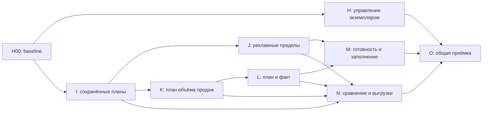

# GPT Luna: рабочее пространство планирования магазина

Дата: **19.10.2026**. Статус: **PREPARED / NOT_STARTED**.
Журнал исполнения: `LUNA_PLANNING_WORKSPACE_PROGRESS_2026-10-19.md`.
Основание и границы аудита: `PLANNING_WORKSPACE_AUDIT_2026-10-19.md`.

## 1. Поручение

Развить существующий Telegram-продукт: от временного расчёта цены к сохранённым планам, пределам рекламных расходов, экономике заданного объёма продаж и проверяемому сравнению плана с фактом. Дополнительно сделать запуск, статус и остановку локального экземпляра понятными владельцу.

Выполнить обязательные модули **H–O**, поэтапно и по зависимостям. Буквы продолжают уже реализованный пакет A–G. Оценочный объём — **20–40 инженерных часов**; это оценка сложности, а не обещание длительности работы конкретной модели. Работать автономно в пределах возможностей среды и лимитов. Не растягивать работу ожиданиями, повторными прогонами или косметическим рефакторингом ради продолжительности.

Результат — работающие пользовательские сценарии, meaningful regression tests, согласованная документация и PR с зелёным CI на актуальном коде. **Слияние, развёртывание и запуск реального бота в это поручение не входят.** Создание этого документа само по себе не запускает реализацию.

## 2. Исходная точка

- Проверенный локальный `main`: `722f368526c278b701cbfd69f3dbb9a474d52386`.
- PR [#702](https://github.com/dopf129-pixel/ai-business-assistant/pull/702) слит в `main`; он содержит проверенный совокупный пакет периодной аналитики и A–G, включая исправления review R1–R10.
- [Verify 39165543772](https://github.com/dopf129-pixel/ai-business-assistant/actions/runs/39165543772) для merged main завершён успешно: Windows/Python 3.12, Linux/Python 3.11, полный pytest, compileall, production Docker build/runtime smoke. Зафиксированный результат прошлого исполнения — по **3 425 passed**. При подготовке этого ТЗ повторно прочитаны статусы jobs; полный suite заново не запускался.
- Обзор товаров, пакет из 2–10 SKU, целевая маржа, сравнение цен, чувствительность, CSV/JSON, диагностика и версия процесса уже реализованы. Их нельзя заново записывать как будущие функции.
- Локально изменены `data/tasks.json`, `data/users.json`; есть lock и временные каталоги pytest с ACL-ограничениями. Сохранить, исключить из новых commits/PR. Ничего автоматически не восстанавливать и не очищать.
- Некоторые верхние записи `CURRENT_STATE.md`, `ROADMAP.md` и старых handoff ещё описывают состояние до слияния. Обновить актуальный указатель в H00, сохранив исторические свидетельства.

В H00 перепроверить текущий HEAD и GitHub: новые изменения могли появиться после подготовки. Предпочитать актуальный проверенный `main`, содержащий названную функциональность. Не откатывать его к указанному SHA.

## 3. Что получить для пользователя

1. Запустить, проверить и остановить свой экземпляр бота без поиска случайного `python.exe`.
2. Сохранить одиночный или пакетный план, вернуться к нему после перезапуска, сделать копию и сравнить версии.
3. При выбранной цене увидеть допустимую рекламную долю для безубыточности и целевой маржи.
4. Ввести собственное количество успешных продаж по выбранным SKU и получить экономику всей выбранной группы с дополнительными плановыми расходами и общим налогом.
5. Сопоставить этот план с подтверждёнными фактическими показателями за тот же период и понять причины несопоставимости остальных строк.
6. Через список готовности последовательно заполнить пропуски, затем скачать ровно тот план/сравнение, который открыт на экране.

Пример основного пути: `Обзор товаров → План цен → Допущения → Сохранить план → Мои планы → Количество продаж → Рекламный предел → Сравнить с фактом → CSV/JSON`.

## 4. Обязательное чтение и реальные точки расширения

Сначала прочитать `AGENTS.md`, `CURRENT_STATE.md`, `DECISIONS.md`, `TEST_MAP.md`, `ROADMAP.md`, `README.md`, `docs/telegram-user-guide.md`, это ТЗ и журнал. Затем читать реализации по этапу.

| Контур | Действующие файлы | Использование |
|---|---|---|
| Арифметика одной продажи | `app/services/unit_price_scenario_service.py` | Единственный действующий прямой расчёт одной продажи; новый solver вызывает его |
| Цена для маржи | `app/services/unit_price_target_planning_service.py` | Существующие правила ввода, ограниченного поиска и прямого подтверждения |
| Источники сценария | `app/services/unit_price_scenario_source.py` | Bounded source snapshot, provenance, средние баллы, tax policy |
| Пакет | `unit_price_batch_plan_service.py`, `telegram_unit_price_batch_plan_runtime_service.py` в `app/services/` | Версии, manual assumptions, exact identity, CAS-публикация |
| Одиночный редактор | `app/services/telegram_unit_price_calculator_runtime_service.py` | Явные новые публичные методы экспорта/восстановления recipe при необходимости |
| Чувствительность | `unit_price_sensitivity_service.py`, `telegram_unit_price_sensitivity_runtime_service.py` в `app/services/` | Сохранить freshness/lifecycle и существующий перенос candidate |
| Фактическая прибыль | `assistant_period_profit_runtime_service.py`, `period_profit_summary_service.py`, `period_profit_sku_runtime_service.py` в `app/services/` | Finalized facts; не извлекать деньги из отформатированного текста |
| Периодные проекции | `app/period_profit_comparison_contract.py`, `app/period_profit_comparison_bridge.py`, `app/period_profit_sku_contribution.py` | Сохранить metric statuses, basis, reconciliation; top list не полная выборка |
| Налог | `app/services/tax_service.py` | Авторитетная налоговая политика и округление; не создавать второй налоговый движок |
| Изоляция и SQLite | `tenant_context.py`, `tenant_storage.py`, `ozon_account_repository.py`, `expense_repository.py` в `app/services/` | Действующий tenant = пользователь и магазин; отдельные planning tables в tenant DB |
| Снимки и бюджеты | `scoped_transient_snapshot_store.py`, `period_profit_operation_diagnostics.py` в `app/services/` | Ограниченные runtime views, parent/child budgets, tickets, cancel |
| Выгрузки | `analytics_export_service.py`, `analytics_export_serializer.py` в `app/services/`; Telegram sender | Расширять виды документов и проекции, сохранять format/size/formula guards |
| Production composition | `app/telegram_assistant_factory.py`, `app/services/assistant_button_handler_service.py`, `app/services/assistant_keyboard_service.py` | Constructor injection, public routing, существующая навигация |
| Запуск | `start_bot.ps1`, `app/telegram_api_bot.py`, `app/telegram_app_layer/telegram_api_bot.py` | Main lifecycle; `build_application()` сохраняет отсутствие запуска сети |

Файлы нового контура называть по ответственности, например `saved_planning_plan_repository.py`, `saved_planning_plan_service.py`, `unit_price_advertising_limit_service.py`, `sales_mix_plan_service.py`, `plan_fact_comparison_service.py`. Это предлагаемые имена, не требование создать все файлы независимо от фактической структуры. Не добавлять универсальный framework, новый task engine, ORM или web server ради этих функций.

Действующие решения: Ozon только чтение; account-level денежная authority; подтверждённые внешние расходы; история себестоимости; evidence Return COGS; **Price Planning Scenario Isolation**. В реестре есть повторённые исторические номера — ориентироваться также на тему.

## 5. Разрешения и готовые продуктовые решения

Выполнение этого ТЗ разрешает добавление кода, осмысленных тестов, документации и новых изолированных planning tables в существующем SQLite-подходе. Разрешены локальные feature branches, небольшие commits, push и PR с тестовыми данными. Каждое сохранение/изменение пользовательского плана в самом продукте происходит по явному действию пользователя.

Это разрешение не распространяется на перенос или редактирование реальных данных продавца во время разработки, реальные изменения Ozon, авторассылки, production migrations, обновление запущенного бота, merge и deploy. Готовые PR передать на независимый review.

Предварительно выбраны следующие правила, по ним не нужно запрашивать бизнес-решение:

- Цена — цена продавца Ozon; сценарий первой версии FBO, одна успешная продажа. FBS не подменять FBO.
- Баллы в плане — действующее взвешенное среднее либо ручное допущение; правило фактического налога не меняется.
- Сохранённый план — отдельный плановый документ; он не является себестоимостью, внешним расходом, налоговой настройкой или финансовым фактом.
- Количества продаж вводит пользователь. Это план успешных продаж, а не прогноз спроса, количество заказов или обещание выкупа.
- Ноль является допустимым только при явном вводе или подтверждённом фактическом нуле. Отсутствующее значение остаётся неизвестным.
- Дополнительные расходы плана задаются вручную отдельными строками и не записываются в учёт внешних расходов магазина.
- Никакого автоматического распределения account-level рекламы, хранения, Return COGS или постоянных расходов между SKU.
- Для сохранённых планов сначала архивирование; физическое удаление только отдельным явно подтверждённым действием с указанием конкретного документа.
- Платные источники и новые Ozon endpoints не нужны для обязательного пакета. Реальные ответы не придумывать. Если понадобится уточнить внешний контракт, искать первичную официальную документацию и записывать ссылку/дату.

## 6. Сквозные контракты

### 6.1. Факт, допущение, сохранённый документ

Различать observed fact, manual assumption и saved historical projection в каждом новом результате. Для поля хранить единицу, происхождение, период/дату источника и статус. Для результата — scope, completeness, calculation version и дату построения.

Decision «transient scenario» не переписывать задним числом. В I00 оформить небольшое **аддитивное** архитектурное решение: transient editor остаётся прежним; пользователь может явно сохранить allowlisted planning recipe и историческую проекцию в новом пространстве. Оно не участвует в factual queries. Это разрешённое расширение, без замены существующего workflow.

Сохранение не продлевает source TTL. После перезапуска сохранённый снимок всегда исторический: его можно читать/сравнивать как сохранённое допущение, но он не получает статус свежего Ozon source. Для нового актуального расчёта нужны явное действие, проверка identity/магазина и получение текущей политики/источников. Не сохранять monotonic clock как межпроцессное время.

### 6.2. Identity, ownership и параллелизм

Все операции связывать с authenticated owner, active store tenant, точной catalog identity и revision. Пользовательские callback/JSON не могут задавать произвольный tenant, путь DB или владельца. При смене магазина/отключении/сбросе transient state очищается; сохранённые документы другого магазина не удаляются и не показываются.

Использовать opaque callback tokens ≤64 bytes UTF-8. Любая запись проходит atomic expected-revision check; поздний refresh/edit/save/confirm не перезаписывает более новую версию. Повторное нажатие не создаёт дубликат. Блокировку БД не держать во время HTTP.

### 6.3. Числа и суммы

В пользовательских inputs и durable JSON хранить деньги и ставки как нормализованные decimal strings. Проверять finite, magnitude, precision и bounds. Для фактов из старых float-контрактов делать контролируемую нормализацию на границе; глобально не переписывать финансовую арифметику.

Маржа = прибыль / выручка × 100. Цель проверять по каноническим денежным результатам до форматирования процентной строки. Не принимать 24,99% за 25% из-за округлённого UI. Проценты разных товаров не усреднять без весов.

Итог налога для sales mix считать один раз по агрегированным выручке, баллам и прибыли до налога через `TaxService`. Сумма налогов отдельных продаж не является общим налогом для всех режимов. Не распределять общий налог по строкам без отдельной согласованной модели.

### 6.4. Состояния и ошибки

Для новых read models минимум: `READY`, `INCOMPLETE_INPUTS`, `HISTORICAL_ASSUMPTIONS`, `SOURCE_STALE`, `SOURCE_UNAVAILABLE`, `IDENTITY_UNRESOLVED`, `NOT_COMPARABLE`, `BUDGET_EXHAUSTED`, `REVISION_CONFLICT`, `UNSUPPORTED_SCHEMA` там, где они применимы. Статус источника и статус математического расчёта — отдельные признаки.

Ошибка доставки файла не отменяет сохранённый план и не выдаётся за успешную отправку. Ошибка сохранения не выдаётся за успешную запись. Частичный factual report не переименовывается в полный. Технические коды доступны в деталях/диагностике; основной экран объясняет действие человеческим языком.

### 6.5. Лимиты первой версии

| Объект | Лимит и поведение |
|---|---|
| Товаров в плане | 1–10; один SKU не дублируется под разными offer aliases |
| Период sales mix | 1–366 календарных дней включительно, даты в принятой магазинной семантике |
| Количество | целое 0–100 000 на SKU, всего ≤1 000 000; все нули — явный пустой план без процента маржи |
| Дополнительные расходы | до 20 строк; сумма от 0 до 1 000 000 000 ₽; отрицательные корректировки в первой версии не поддерживать |
| Агрегированные суммы | модуль каждого money total ≤1 000 000 000 000 ₽; превышение/потеря поддерживаемой точности — controlled input error до TaxService |
| Сохранённые документы | до 200 на owner/store, включая архив; никаких автоматических удалений |
| Ревизии документа | до 20; при лимите предложить создать отдельную копию, не удалять историю молча |
| Сохранённая ревизия | allowlisted JSON ≤64 KiB; превышение отвергать целиком |
| Список планов | 10 документов на страницу; bounded SQL, фильтр active/archive |
| Advertising solver | ставка 0–100% с шагом 0,01 процентного пункта; общий cap 128 прямых оценок на запрос двух пределов |
| Advertising caps группы | максимум 10 × 128 = 1 280 прямых оценок на весь план; ноль HTTP, без перезапуска поиска при рендере/выгрузке |
| Runtime views | TTL 600 s, не более 64 новых views в одном runtime; чтение не освежает source age |
| Source операция | дочерний cap 120 s / 128 HTTP attempts, подчиняется меньшему остаточному parent budget |
| Экспорт | действующие 2 MiB / 5 000 строк / 64 колонки; без молчаливого усечения |
| Локальная остановка | bounded wait до 15 s; после таймаута статус «не остановлен», force только отдельным явным параметром |

## 7. Порядок исполнения

Рекомендуемая последовательность для одной модели: H00–H04 → I00–I05 → J00–J03 → K00–K04 → L00–L04 → M00–M03 → N00–N03 → O00–O02. Независимый этап можно продолжать, если заблокирован другой, с точным статусом в журнале.

## 8. Модуль H — достоверная база и управление экземпляром

### H00. Зафиксировать фактическую базу

1. Записать branch/HEAD, состояние index/worktree, файлы чужих изменений, hashes пользовательских JSON без чтения содержимого в отчёт.
2. Проверить merged main и актуальный CI. Найти уже реализованные A–G и R1–R10, не открывать их заново.
3. Поднять в CURRENT_STATE/ROADMAP свежий указатель: старые PR уже закрыты/слиты; исторические записи сохранить как историю.
4. Проверить тестовые настройки и доступный temp/storage root без `.env` и данных продавца. Сначала один диагностический probe при необходимости; ACL не исправлять рекурсивной сменой прав.
5. Заполнить журнал baseline. Готово, когда известен воспроизводимый способ проверок и сохранена исходная работа.

### H01. Контракт одного локального экземпляра

1. Проследить реальный lifecycle: PowerShell → canonical Python main → PTB initialization/polling/shutdown.
2. Описать до кода механизм единственного экземпляра и безопасного stop. Основа — удерживаемая процессом OS-блокировка и проверяемая generation; PID-файл сам по себе не доказывает владение процессом.
3. Одинаковый bot token под одним пользователем на одном host не должен запускать два polling экземпляра из разных копий checkout. Разные боты могут работать одновременно. Секрет/его ключ блокировки не выводится в UI, логах и support JSON.
4. Guard действует и для прямого `python -m telegram_api_bot`, а `build_application()` не начинает polling, не захватывает lock и остаётся тестируемым без сети.
5. Не добавлять зависимость/web server ради lifecycle. Если используется stdlib platform-specific code, покрыть Windows и Linux; failure освобождает ресурсы.

### H02. Управляемый запуск, статус и остановка

1. `start_bot.ps1` по умолчанию запускает видимый процесс; фоновый режим только по явному флагу. Существующая первоначальная настройка `.env` и venv сохраняется.
2. Добавить команды/скрипты status и stop, точные имена закрепить в README. Состояния: STOPPED/STARTING/RUNNING/STOPPING/UNKNOWN; process alive не означает готовый Telegram polling.
3. Status показывает проверенные revision, время старта, режим и состояние своего экземпляра без токена/API-ключей. Сетевой запрос для status не нужен.
4. Stop посылает запрос именно владеющему generation процессу; сначала штатное завершение polling/приложения. Повторный stop безопасен. Stale metadata и переиспользованный PID не могут остановить другой Python/PowerShell.
5. При запрете ОС честно сообщить об отказе. Не завершать все `python.exe`, не вызывать автоматическое повышение прав и не обходить ACL. Force допускается только отдельным явным флагом после проверки идентичности процесса.

### H03. Проверки lifecycle

- Конкурентные старты: ровно один владелец lock; losing process не начинает Telegram polling.
- STARTING failure, нормальная остановка, Ctrl+C/SIGTERM, stale marker, PID reuse и чужой процесс; два разных bot tokens не блокируют друг друга.
- Status не читает Git HEAD вместо process revision и не заявляет readiness до реальной стадии готовности.
- Проверки используют fake application/transport и свои dummy subprocesses; не трогают реальный бот и чужие процессы разработчика.
- Windows/Linux integration проверяет фактический межпроцессный lock/stop, а не только mock возвращаемого bool.

### H04. Приёмка H

Обновить README/guide с короткими отдельными копируемыми блоками PowerShell: foreground start, background start, status, stop. Полный pytest и CI нового SHA, включая Docker healthcheck. Не запускать реальный бот в ходе приёмки. Зафиксировать PR/результаты и продолжить I.

## 9. Модуль I — библиотека сохранённых планов

### I00. Durable planning contract

1. Оформить разрешённое аддитивное решение к Price Planning Scenario Isolation в DECISIONS с уникальным номером/темой.
2. Разделить saved recipe, historical calculation projection и ephemeral runtime session. Сохранять allowlisted inputs, exact identity, manual/source provenance, target, source periods/as-of, schema/calculation versions, owner/store и revision.
3. Credentials, raw API, exception bodies, runtime callback tokens, operation tickets и monotonic timestamps не попадают в durable payload.
4. Один документ содержит 1–10 SKU, необязательный sales mix и расходы плана. Derived fields создаёт сервис, клиент не присылает их как trusted facts.
5. Статусы active/archive и expected revision задать отдельно от финансовой готовности. Зафиксировать случаи неподдерживаемой/повреждённой записи без перезаписи оригинала.

### I01. Repository и атомарные операции

1. Добавить отдельные planning tables в существующую tenant SQLite DB; применять `tenant_storage_path`, constructor injection и parameterized SQL. Не переносить старые таблицы/данные.
2. Create/update/rename/archive/restore/remove работают внутри транзакции, проверяют owner/store, ожидаемую revision и idempotency key.
3. Две одновременные правки одной revision дают один success и один REVISION_CONFLICT, без lost update. Повтор подтверждённого save возвращает тот же результат.
4. Успех сообщается только после commit; disk full/read-only DB/lock timeout не создают пустой успех. Прерванная транзакция сохраняет прежнюю валидную revision.
5. Schema migrations additive и idempotent; неизвестную будущую schema не понижать. Проверить существующую DB с legacy tables на синтетическом fixture.

### I02. Явное сохранение из существующих редакторов

1. Кнопка «Сохранить план» доступна в single и batch. Capture берёт одну version-bound публичную проекцию, а не читает runtime private dict напрямую.
2. Передать название 1–80 символов; incomplete plan разрешено сохранить как черновик с точными пропусками. Не маскировать его как READY.
3. Изменение сценария во время ввода названия/подтверждения делает старый save ticket недействительным. Смена магазина и чужая кнопка также не сохраняют новый сценарий под старым названием.
4. Ручные cost/advertising/price остаются плановыми. Реальные seller cost, expenses, tax settings, product decision history и Ozon не меняются.
5. Результат ясно различает «план сохранён локально» и любые внешние действия. Не использовать глобальное read_only как ложное обещание отсутствия локальной записи.

### I03. «Мои планы»: открыть, копировать, продолжить

1. Добавить ограниченный paged список, фильтр архива, карточку с датой/revision/scope/готовностью, rename/copy/archive/restore и подтверждённое удаление конкретного документа.
2. Открытие/просмотр/история читают SQLite и не вызывают Ozon. Экран называется сохранённым планом и показывает возраст допущений.
3. «Продолжить по сохранённым допущениям» создаёт новый transient editor с исторической меткой. Открытие не перезаписывает другой активный сценарий без явного перехода/подтверждения.
4. «Обновить источники и создать актуальный расчёт» revalidates catalog identity и текущую tax policy. Сохранённые ручные overrides сохранять только для точного SKU и допустимых полей; старую source policy не выдавать за новую.
5. Обновление не меняет сохранённую revision автоматически. «Сохранить изменения» создаёт следующую revision через CAS; «Сохранить копию» — новый документ.

### I04. История, пределы и деградация

1. Reopen после рестарта читает ту же revision; UTC timestamps с timezone, отсутствующая/будущая timestamp не превращается в fresh.
2. Catalog SKU удалён/в архиве/неоднозначен: исторический план доступен, актуальная загрузка показывает unresolved identity; никаких автоматических mappings.
3. Quota/size/revision limit не удаляют документы. Показать вариант экспорта, копии или явно подтверждённого удаления.
4. Повреждённый документ не блокирует список остальных, выдаёт controlled diagnostic; не создавать новый пустой документ поверх него.
5. Restart/store switch/session eviction отзывают transient tokens, но не удаляют durable планы.

### I05. Приёмка I

Repository tests на настоящем временном SQLite: tenant isolation, CAS, repeated save, rollback, schema upgrade, failure, reopen. Public handler flow single/batch → save → restart services → list → historical read → explicit refreshed copy. Проверить отсутствие любых factual writes с fail-on-write fakes. Полный pytest/CI, docs и журнал.

## 10. Модуль J — допустимая рекламная нагрузка

### J00. Чистый контракт предела

1. При фиксированных price/cost/fees/commission/points/tax policy найти максимальную рекламную ставку **на сетке 0,01 процентного пункта**, сохраняющую прибыль ≥0 и отдельно целевую маржу.
2. База ставки — цена продавца; рекламные рубли/шт. получить каноническим прямым калькулятором. Это плановая допустимая доля, не прогноз CPC/CPO, показов, заказов или эффективности кампании.
3. Все сравнения выполнять по подтверждённым каноническим money/profit, не по отформатированной марже. При missing input результата нет; при полностью заданных данных и недостижимости цели это отдельный outcome.
4. Подтвердить монотонность для поддержанных режимов при фиксированных остальных inputs. Нестандартная ошибка/неподдержанная политика не дают права на бинарный поиск с выдуманной гарантией.

### J01. Bounded solver

1. Переиспользовать прямой calculator; проверить крайние точки 0% и 100%, затем ограниченный поиск по integer ticks 0..10 000.
2. Подтвердить найденный tick и соседний следующий: найденный достигает цель, следующий нет, либо достигнут верхний край. Если проверки не дают доказательства границы — `LIMIT_NOT_CONFIRMED`.
3. Общий budget двух поисков ≤128 вычислений; ноль HTTP и factual writes. Кэш/мемоизация только внутри запроса и с ключом всех inputs/target/policy.
4. Вернуть cap в %, канонические ₽/шт., текущую долю/расход, запас до предела в процентных пунктах и рублях. Отрицательный запас допустим и объясняется.

### J02. Telegram и сохранённые планы

1. Кнопка «Сколько можно тратить на рекламу?» в single, строке batch и saved plan.
2. Экран показывает выбранную цену, цель, текущую долю, два предела, запас, неизвестные параметры и исторический/актуальный статус допущений.
3. Подставить предел можно только в текущую локальную версию сценария по явной кнопке с повторным прямым расчётом. Никаких действий с рекламными кампаниями.
4. После смены цены/cost/points/tax/source старый результат и callback недействительны. Для saved plan изменение сохраняется отдельным I02/I03 действием.

### J03. Приёмка J

Контроль 15.1 ниже, режимы NONE/USN_INCOME/USN_INCOME_MINUS_EXPENSES, tax minimum switch, explicit zero/missing, отрицательная прибыль даже без рекламы, верхний край 100%, граница rounding и monotonic validation. Public runtime regression: old cap после новой цены/store switch/refresh не применяется. Полный pytest/CI, docs и журнал.

## 11. Модуль K — экономика заданного объёма продаж

### K00. Контракт sales mix

1. На базе 1–10 строк плана пользователь задаёт период и целое количество **успешных продаж** по каждому SKU. Цена и расходы строки — фиксированные допущения этого плана.
2. Количество по умолчанию неизвестно. Ноль вводится явно; не брать без подтверждения ordered_units из Analytics как успешные продажи.
3. Дополнительные расходы: список `название + сумма за весь период`; нужно явно подтвердить список, включая пустой список/0 ₽. Один расход не может одновременно считаться фиксированным и умножаться на Q.
4. Результат относится к выбранной группе и заданному периоду. Он не объявляется итоговой прибылью всего магазина и не прогнозирует объём продаж.

### K01. Агрегирование и общий налог

1. Получить канонические компоненты каждой успешной продажи через UnitPriceScenarioService; умножить округлённые money components на Q в Decimal.
2. Сложить revenue, discount points, commission, advertising, fees, COGS и прибыль до налога. Дополнительные плановые расходы вычесть один раз из общей прибыли до налога.
3. Вызвать TaxService один раз с агрегированными revenue/gross_profit/discount_points и одной согласованной tax policy. При ошибке налог и прибыль unknown.
4. Итоговая прибыль = общая прибыль до налога − общий налог. Общая маржа = итоговая прибыль / общая выручка; при нулевой выручке процент не определён, не 0% по умолчанию.
5. По SKU показывать до-налоговый вклад и компоненты. Не приписывать SKU долю общего налога/фиксированных расходов. Не суммировать standalone profits как итог.
6. При partial inputs показать подтверждённый subtotal с перечислением исключённых строк; total profit/margin всей выбранной группы недоступны. Пустая строка с Q=0 не требует будущих расходов для нулевого вклада, если identity и сам ноль подтверждены.

### K02. Редактор и версия плана

1. Ввод Q, периода и расходов через существующую text routing модель с owner/store/version-bound tickets. Неверный ввод не сбрасывает остальные строки.
2. Менять Q/допущения можно локально без источников; сохранять документ только явной кнопкой.
3. Смена исходной batch revision отзываeт старый mix result. Поздний refresh не перезаписывает более новый Q или расходы; CAS и operation generation проверять под lock.
4. Добавление/удаление SKU выполняется через новую revision с явным preview; не переносить Q на другой товар по индексу строки.

### K03. Таблица результата и рекламные бюджеты

1. Показать Q/price/revenue/COGS/commission/ad/fees/pre-tax contribution по SKU и общие дополнительные расходы/налог/profit/margin.
2. Рекламные суммы = заданный ad/шт. × Q. Допустимый рекламный бюджет для группы выводить только как сумму совместимых подтверждённых per-SKU caps, с пометкой ограничений; не обещать достижение общей цели при другой структуре продаж.
3. При одинаковой цели и налоге, рассчитанном на группу, явно различать «предел отдельного SKU» и «цель группы». Не подставлять сумму per-SKU caps как решённую оптимизацию общего бюджета.
4. Показывать coverage и исключённые расходы: возвраты/отмены, хранение и account costs не появляются в сумме без явных подтверждённых допущений.

### K04. Приёмка K

Контроли 15.2/15.3: weighted margin, общий налог вместо суммы, minimum tax/убыточная строка, нулевой/unknown Q, mixed tax policies, расходы один раз, partial subtotal, unit rounding ×Q, cap quantities/overflow. Сквозной flow с сохранением/reopen и неизменными business records. Полный pytest/CI, docs и журнал.

## 12. Модуль L — план и подтверждённый факт

### L00. Карта сопоставимости

1. Проследить реальные finalized DTO результата прибыли/SKU, не текст Telegram. Зафиксировать поля revenue, successful units, pre-tax components, tax, final profit и их status/basis/period/scope.
2. Для выбранных SKU реализовать маленький публичный fact projection adapter поверх существующего canonical query/result; не строить новый finance engine и не обращаться к private runtime dictionaries.
3. Не использовать ограниченный top-SKU list как полный набор. Если требуемая строка не сохранена в снимке, получать её через ограниченный существующий read-only selected query либо добавлять bounded allowlisted projection в момент формирования canonical report.
4. Метод должен сохранять финальные cost/return/identity/coverage semantics. Источники не имеют права создавать recognition/commit/task/history факты ради сравнения. Существующий учётный workflow этим адаптером не обходить и не повторять.
5. Зафиксировать реальную карту: какие показатели доступны сейчас и почему остальные не сопоставимы. Если внешний контракт не подтверждён, ограничить отдельную метрику, продолжить независимые метрики и модули; не выдумывать данные.

### L01. Получение факта

1. Пользователь выбирает сохранённую revision и тот же период. Scope — ровно выбранные SKU этого магазина.
2. Предпочесть уже finalized подходящий owner/store snapshot; чтение и экспорт не обновляют Ozon. Новая загрузка только по явной кнопке под одним inherited budget.
3. Сохранять единое as-of/operation context. Для 10 SKU не создавать десять независимых полных budgets и не загружать весь аккаунт per SKU.
4. Unsupported/partial/rate limited/source stale — отдельные статусы. Ни один missing cancellation/return indicator не меняется на 0 и не подменяет successful quantity.
5. Поздняя загрузка после смены плана/revision/магазина не публикует чужой результат.

### L02. Pure comparison

1. Metric pair сопоставим только при совпадении owner/store/identity/period/currency/unit/revenue basis/quantity population и нужной completeness. Проверять tax policy/calculation version для налоговых/итоговых показателей.
2. Показывать plan, fact, delta=fact−plan и delta% только при определённом ненулевом плане. При плане 0 — delta в единицах и «процент не определён».
3. Account-level actual profit нельзя вычитать из planned profit выбранных SKU. Общий store tax нельзя сравнивать с налогом выбранной группы без совместимого scope. Общую прибыль сравнивать только при подтверждённой одинаковой финансовой базе; иначе показывать отдельно доступные компоненты.
4. На сопоставимой выручке дать точный двухфакторный bridge: `(Qф−Qп)×Pп` и `Rф−Qф×Pп`. Второе слагаемое — эффект фактической средней выручки на единицу, а не доказанный эффект изменения установленной цены.
5. Сумма двух факторов обязана равняться `Rф−Rп`. Использовать Decimal без промежуточного округления средней Pф; при Qф=0 и подтверждённой Rф=0 эффект средней цены 0 по алгебре, сама Pф не определена.
6. Эти факторы не доказывают причины изменения спроса, рекламы или возвратов. Нет достаточных данных — NOT_COMPARABLE с конкретной причиной, а не совет повысить цену.

### L03. Telegram представление

1. Основной экран — сопоставимые Q/revenue/components и coverage. Детали объясняют basis, источники, неполноту и неподтверждённые показатели.
2. Кнопки: выбранная revision, изменить период, детали сопоставимости, явно обновить факт, выгрузки.
3. Результат использует один immutable comparison snapshot. Navigation и файл не запускают query повторно и не пересчитывают snapshot на изменившейся revision.
4. Истечение TTL прекращает право текущих callbacks на перенос/refresh; просмотр сохранённой исторической проекции имеет отдельную маркировку и не притворяется актуальным фактом.

### L04. Приёмка L

Контроль 15.4; разные scopes/quantity populations/revenue bases, plan=0, actual Q=0, missing/partial, duplicates/ambiguous identity, stale callback, source budgets/rate limit/cancel. Минимум одна public integration использует настоящий canonical fact projection с синтетическими финансовыми fixtures, а не только handcrafted готовый comparison DTO. Полный pytest/CI, docs и журнал.

## 13. Модуль M — готовность плана и последовательное заполнение

### M00. Единая projection готовности

1. Собрать whitelist причин из I/J/K/L: неизвестная себестоимость, реклама, fees, points, Q, неподтверждённая identity, stale source, несовместимый fact scope.
2. Отделить «математика посчитана по допущениям», «допущения актуальны» и «есть сопоставимый факт». Одного универсального READY недостаточно.
3. Для каждой причины дать одно допустимое действие: локальный ввод, явное обновление, текущий identity flow либо объяснение недоступности. Не выводить методы/endpoint вместо понятного действия.
4. Не строить новый планировщик задач и не писать автоматические product decision proposals/history.

### M01. Экран «Готовность плана»

1. Показать сколько из выбранных SKU готовы, чего не хватает и какие расчёты уже доступны. Количества сверяются с фактическими строками.
2. Переход к конкретному полю/строке возвращает в тот же план/revision после исправления. Не заставлять проходить всю партию сначала.
3. Ручной 0 требует явного ввода; не предлагать «заполнить всё нулями».
4. Все локальные изменения доступны в preview перед сохранением; исходная durable revision остаётся прежней до commit.

### M02. Навигация, отмена и конфликты

1. Проверить переходы main menu, single, batch, sensitivity, saved plans, quantity input и completeness: активный ввод обслуживает только свой ticket.
2. Старый confirm не применяет новый draft; store switch/reset/disconnect отзывают все новые transient sessions, durable планы сохраняются.
3. При revision conflict показать сохранённую новую версию и возможность скопировать свои правки в новый план после явного выбора. Не делать silent last-writer-wins.
4. Никакой автоматической загрузки/публикации при возврате на страницу; refresh — отдельное действие.

### M03. Приёмка M

Public handler flows для mixed single/batch/sensitivity/plans/text, Event-controlled concurrency вместо timing sleeps, correction of missing/invalid states, cancellation, store A→B→A и two owners. Новый экран не заменяет существующую seller attention summary. Полный pytest/CI, docs и журнал.

## 14. Модуль N — сравнение планов, выгрузки и объяснения

### N00. Сравнение двух сохранённых вариантов

1. Выбрать две сохранённые revision/копии одного магазина и показать изменения inputs: price, cost, advertising, points, fees, Q, дополнительные расходы, tax policy.
2. Для одинакового compatible scope дать delta revenue/profit/margin; процент маржи показывать в процентных пунктах. Разный период/состав/policy явно маркировать; неодинаковые базы не выдавать за одинаковый эксперимент.
3. Сравнение сохранённых исторических проекций не вызывает Ozon и не выдаёт прежние inputs за актуальные. Если calculation version несовместима, предложить создать два новых локальных пересчёта по единой версии, сохранив оригиналы.
4. Derived results не пересчитываются в export иначе, чем в открытом view. У пользователя видно, меняется цена/объём или оба параметра.

### N01. Расширение существующих экспортов

1. Добавить отдельные export kinds saved plan, advertising limit, sales mix, plan/fact, plan comparison в существующий serializer/service/document contract.
2. CSV и JSON содержат schema/calculation version, revision, scope, units, provenance, statuses, as-of/period и exact visible projections. Decimal money сохраняет копейки; missing — пустое/nullable с reason, не 0.
3. Читаются все строки выбранного snapshot scope, не только страница; соблюдаются существующие limits, formula injection protection, escaping Unicode/newlines и безопасное имя файла.
4. Исторические проекции/устаревшие источники одинаково помечены на экране и в файле. Сохранённый документ и свежий runtime view имеют разные lifecycle semantics.

### N02. Безопасная диагностика и доставка

1. Использовать текущий Telegram document sender; sender success только после успешной отправки. Ошибки не обнуляют документы и не открывают повторно factual queries.
2. Diagnostic export использует прежнюю строгую allowlist: schema/status/counters, обезличенные aliases. Деньги, названия планов/товаров, identities, paths, credentials, local generation/stop secrets не входят.
3. Пользовательский report export может содержать его собственные цифры/товары; это отдельный вид документа с owner/store проверкой, не support diagnostic.
4. Защитить plan JSON от принятия seller-cost CSV/import handler. Общий JSON import в этом пакете не нужен; не исполнять содержимое файлов как инструкции.

### N03. Руководство и приёмка N

Guide должен объяснять сохранение, исторические допущения, единицы Q, общий налог, лимит рекламы, сравнение с фактом и границы расчёта. Приложить короткие синтетические примеры экрана. Проверить UTF-16 сообщение, 64-byte callbacks, полный scope CSV/JSON, injection, размер, delivery failure и public factory wiring. Полный pytest/CI, docs и журнал.

## 15. Обязательные числовые примеры

Примеры 15.1 и компоненты 15.2 при подготовке проверены прямыми синтетическими вызовами действующих UnitPriceScenarioService/TaxService. Это проверка чисел ТЗ, не приёмка нового функционала. Идентификаторы в новых fixtures — вымышленные.

### 15.1. Рекламный предел одного SKU

Inputs: цена 500 ₽; cost 150 ₽; комиссия 20%; logistics 25 ₽; last mile 5 ₽; acquiring 5 ₽; points 20%; налог USN_INCOME 6%.

| Рекламная доля | Реклама/шт. | Прибыль до налога | Налог | Прибыль | Маржа |
|---|---:|---:|---:|---:|---:|
| 10,00% | 50,00 | 165,00 | 24,00 | 141,00 | 28,20% |
| 13,20% | 66,00 | 149,00 | 24,00 | 125,00 | 25,00% |
| 13,21% | 66,05 | 148,95 | 24,00 | 124,95 | 24,99% |
| 38,20% | 191,00 | 24,00 | 24,00 | 0,00 | 0,00% |
| 38,21% | 191,05 | 23,95 | 24,00 | −0,05 | −0,01% |

При текущих 10% запас до цели 25% = **3,20 п.п. / 16 ₽ на успешную продажу**. Предел безубыточности = **38,20% / 191 ₽** на выбранной сетке. Результат не является обещанием эффективной рекламной кампании.

### 15.2. Два SKU и общая экономика

SKU A — строка 10% из 15.1, Q=10. SKU B: цена 1 000 ₽, cost 400 ₽, комиссия 20%, logistics 50 ₽, last mile 10 ₽, acquiring 10 ₽, реклама 10%, points 20%, тот же налог; Q=5. Дополнительные расходы за период **360 ₽**, введены пользователем.

Итого: successful units **15**, revenue **10 000 ₽**, points **2 000 ₽**, COGS **3 500 ₽**, commission **2 000 ₽**, advertising **1 000 ₽**, fees **700 ₽**. Прибыль до дополнительных расходов/налога **2 800 ₽**, после дополнительных расходов до налога **2 440 ₽**. Налоговая база **8 000 ₽**, налог **480 ₽**, итоговая плановая прибыль **1 960 ₽**, маржа **19,60%**. Это экономика выбранной группы при заданном объёме.

### 15.3. Налог группы не равен сумме налогов строк

USN_INCOME_MINUS_EXPENSES 15%, minimum 1%, points=0. Две строки: revenue по 500 ₽, прибыль до налога +200 ₽ и −100 ₽. Standalone tax = 30 ₽ и 5 ₽, сумма 35 ₽. Aggregate revenue=1 000 ₽, pre-tax profit=100 ₽: regular tax=15 ₽, minimum=10 ₽, итог **15 ₽**, net profit **85 ₽**. Не использовать 35 ₽ и прибыль 65 ₽ как общий результат группы.

### 15.4. Bridge выручки

План: Q=10, P=500 ₽, R=5 000 ₽. Подтверждённый сопоставимый факт: Q=8, R=4 160 ₽. Delta R=−840 ₽. Эффект количества `(8−10)×500` = **−1 000 ₽**; эффект средней выручки на единицу `4 160−8×500` = **+160 ₽**; сумма **−840 ₽**. Средняя 520 ₽ не доказывает изменение установленной цены.

### 15.5. Сохранение и конфликт

Save revision 3 начал ждать имени. Другой action опубликовал revision 4. Подтверждение старого save даёт REVISION_CONFLICT и не меняет revision 4. Два одинаковых повторных подтверждения успешного save не создают два документа/две новые ревизии. После restart historical read не вызывает Ozon и не объявляет source fresh.

## 16. Проверки, GitHub и журнал

После каждого этапа: targeted tests изменённой границы, фактический результат в журнале, актуальные документы, небольшой commit по завершённому reviewable изменению. Не коммитить пользовательские данные, secret files, DB, lock, сырые отчёты, diagnostics и temporary directories.

После каждого модуля с изменениями кода: полный `pytest` (`tests` и `app/tests`), compileall, `git diff --check`, проверка production factories и CI. При инфраструктурном ограничении сохранить traceback/classification, получить чистый Windows/Linux CI текущего SHA. Нельзя назвать модуль VERIFIED на основании только deselected subset или старого CI. Не удалять проблемные тесты ради зелёного статуса. Чистый CI обязан включать весь набор.

Проверки hermetic: `PYTHON_DOTENV_DISABLED=1`, отдельный `AI_ASSISTANT_STORAGE_ROOT`, синтетические tenant/configuration/credentials, mock HTTP. Не импортировать реальную `.env`, не писать в пользовательские DB. Нужные subprocess tests запускают только собственные dummy процессы с cleanup по подтверждённой identity. После нескольких одинаковых ACL failures менять среду проверки, не создавать бесконечные temp копии.

Статусы этапа: NOT_STARTED → IN_PROGRESS → IMPLEMENTED → VERIFIED. Допустимы BLOCKED/NEEDS_REVIEW с точной причиной. IMPLEMENTED не означает принят тестами. Для каждого этапа записывать SHA и тесты; ожидание CI не заменяет следующий независимый этап, но без CI acceptance не завершена.

Предпочтительны 4 reviewable PR: **H**, **I**, **J–K**, **L–N + O evidence**. Если зависимости ещё не слиты, использовать явно stacked bases, максимум эту цепочку вместо отдельных PR на каждую мелочь. Сохранить небольшой commit scope внутри каждого PR. В описании перечислить фактические модули и зависимость; не выдавать top PR за полный независимый diff к main.

В финале показать: какой branch/PR содержит каждый модуль, какой base нужен, какой актуальный code SHA имеет зелёные checks. Наличие кода в зависимой ветке не равно присутствию в `main`. При последующем слиянии bases/CI нужно перепроверять; это не действие данного поручения.

## 17. Модуль O — сквозная приёмка и передача

### O00. Пользовательские сценарии

1. Single → ручные допущения → advertising caps → save → restart services → read historical → refreshed copy → revision conflict.
2. Overview → 2–10 SKU → batch target → save → Q/period/expenses → sales mix → ready checklist → исправление одного поля → explicit save.
3. Saved mix → сопоставимый finalized факт → plan/fact bridge → partial/non-comparable details → CSV/JSON одного snapshot.
4. Две сохранённые версии → input diff/result comparison → historical export; missing input не превращается в 0.
5. Two users/two stores, reset, disconnect/reconnect, expiry/eviction, поздние concurrent source/edit/save callbacks, SQLite failure, Telegram delivery failure.
6. Own dummy process lifecycle: foreground/background start, duplicate start, status, graceful stop, PID reuse. Старые разделы бота доступны и проходят regression tests.

### O01. Финальная техническая приёмка

Полный актуальный pytest, compileall, diff-check, dependency/secret/data review; Windows/Linux CI и production Docker smoke. Проверить совокупный код, включая межмодульные зависимости, на текущем head; зелёный CI отдельной старой ветки не принимает интеграцию. Результаты реальные, counts не копировать из baseline.

### O02. Review handoff

Подготовить `PLANNING_WORKSPACE_REVIEW_HANDOFF_2026-10-19.md`: PR/base/head/CI, выполненные stages, архитектурные изменения, миграции и совместимость, тесты с результатами, ограничения, checklist review. Проверить соответствие итогового текста PR фактическому diff.

Classification: **Architecture Review Required**, поскольку появляются durable planning contract и новые calculation/read-model границы. Independent reviewer должен отдельно проверить сохранение данных, CAS/lifecycle, planning/fact separation, tax aggregation, scopes, бюджеты и process stop ownership. Review не заменять самопроверкой и не считать green CI разрешением merge.

Завершить структурированным development report по AGENTS. Merge/deploy/реальный запуск не выполнять.

## 18. Как работать автономно и переживать сокращение контекста

1. В начале и после compaction читать ТЗ, журнал и git status. Не начинать работу сначала.
2. В журнале всегда оставлять текущий stage, последний завершённый SHA, фактический test/CI result, следующий конкретный шаг и чужие dirty paths.
3. Обновлять журнал после этапа, перед длительным CI ожиданием и перед завершением контекста. Не считать планы в комментариях выполненными фактами.
4. После успешного этапа переходить к следующему разрешённому этапу без промежуточного запроса «продолжать?». Давать краткие progress updates, не прерывая работу финальным ответом.
5. Остановиться только при необходимом бизнес-решении вне раздела 5, неустранимом блокере всех оставшихся обязательных ветвей либо завершении всего пакета. Доступные независимые этапы продолжать.
6. Если не хватает paid/live данных, использовать согласованные conservative statuses и реальные существующие контракты. Не требовать от владельца API-ключи/Client ID/.env и не придумывать поля.
7. Дополнительную feature, не включённую в это ТЗ, записать в backlog, не добавлять бесконечный scope. Обязательные acceptance criteria не ослаблять ради формального закрытия.

## 19. Стартовая команда следующей модели

> Выполняй project_brain/LUNA_PLANNING_WORKSPACE_TASK_2026-10-19.md. Начни с H00, затем двигайся по зависимостям до завершения H–O. Работай автономно, сохраняй существующие изменения и данные. После каждого этапа обновляй журнал, документацию и фактические результаты проверок; после сокращения контекста продолжай по журналу. Заверши на готовых PR с зелёным CI и пакетом для независимого review. Слияние, развёртывание и реальный запуск бота не выполняй. Обращайся ко мне только при необходимом бизнес-решении или неустранимом блокере.
